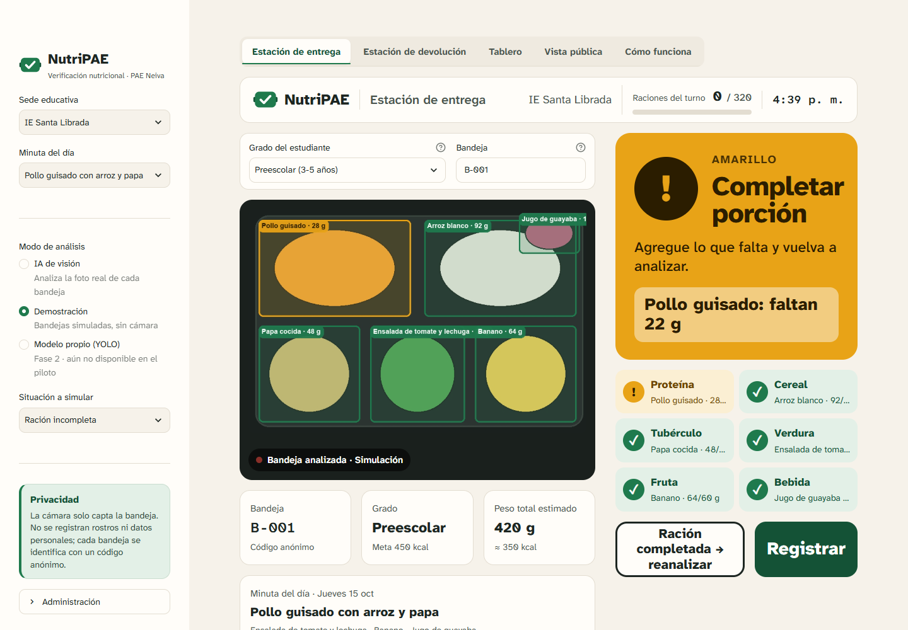
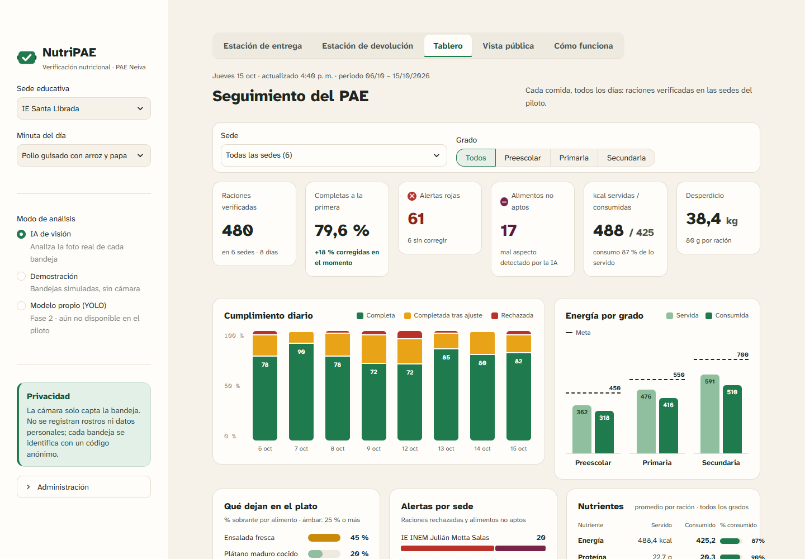

# NutriPAE — Verificación nutricional con IA para el PAE de Neiva

Sistema que revisa **cada ración, cada día** en los comedores escolares con solo una cámara: al entregar la bandeja
verifica que esté completa, con la porción del grado y en buen estado; al devolverla mide qué se consumió realmente y
calcula los nutrientes ingeridos. Todo sin captar rostros ni datos personales.

Prototipo para el **Neiva Fest · Reto Innova 2026** (Convocatoria Pública No. 001 de 2026).

| Estación de entrega | Tablero de seguimiento |
|---|---|
|  |  |

## Ejecutar en local

Requiere Python 3.10 o superior.

```bash
python -m venv .venv
source .venv/bin/activate          # Windows: .venv\Scripts\activate
pip install -r requirements.txt
cp .env.example .env               # Windows: copy .env.example .env  → pega una API key
python -m streamlit run app.py
```

Se abre en `http://localhost:8501`. Basta **una** API key en el `.env`: `OPENAI_API_KEY`, `ANTHROPIC_API_KEY` o
`GEMINI_API_KEY`. Si usas Claude o Gemini instala además su librería (`pip install anthropic` o `pip install google-genai`).
La interfaz nunca muestra claves ni proveedores: se configuran solo en el servidor.

## Cómo se usa

En la barra lateral se elige la **sede**, la **minuta del día** y el **modo de análisis**:

| Modo | Para qué |
|---|---|
| **IA de visión** | Uso real. Analiza la foto de la cámara (o una foto subida) con un modelo multimodal. Es el modo por defecto si hay una API key. |
| **Demostración** | Sin cámara ni internet. Simula bandejas y permite forzar la situación: ración completa, incompleta o con un alimento en mal estado. |
| **Modelo propio (YOLO)** | Fase 2. La app explica por qué el piloto aún no lo usa: necesita entrenarse con fotos reales de bandejas de Neiva. |

Flujo de una ración:

1. **Estación de entrega** → *Analizar ración* → semáforo **verde / amarillo / rojo** con la bandeja anotada y lo que falta.
   Si es amarillo o rojo, la manipuladora completa la ración y pulsa *Ración completada → reanalizar*; se registra el
   veredicto inicial (cumplimiento a la primera) y la ración corregida.
2. *Registrar* → **Estación de devolución** → *Analizar sobrante* → consumo real, nutrientes y un mensaje para el estudiante.
3. **Tablero** → cumplimiento diario, alertas por sede, energía por grado, qué dejan en el plato, nutrientes y exportación CSV.
4. **Vista pública** → resumen semanal por sede para rectores, familias y veedurías (diseñada para móvil).
5. **Cómo funciona** → flujo, reglas del semáforo, privacidad y la ruta de la IA (hoy / fase 2).

Para una demostración del tablero: barra lateral → **Administración** → *Cargar datos de ejemplo* (10 días, 6 sedes).
Borrar registros exige marcar una confirmación.

### Reglas de verificación

- Deben estar los 6 grupos de la minuta: proteína, cereal, tubérculo, verdura, fruta y bebida.
- Cada porción dentro de **±20 %** de la meta del grado; por debajo del 80 % → amarillo.
- Falta un grupo o hay un alimento no apto (mal aspecto) → rojo.
- Sin báscula: la IA estima los gramos con la bandeja de tamaño conocido como escala, la altura visible y la densidad
  típica de cada alimento. Nutrientes según la Tabla de Composición de Alimentos Colombianos (ICBF).

## Configuración (`.env`)

| Variable | Uso |
|---|---|
| `OPENAI_API_KEY` / `ANTHROPIC_API_KEY` / `GEMINI_API_KEY` | Clave del servicio de IA de visión (basta una). |
| `NUTRIPAE_PROVEEDOR` | `openai`, `anthropic` o `gemini`, si hay varias claves. Por defecto, el primero con clave. |
| `NUTRIPAE_MODELO` | Modelo a usar. Por defecto `gpt-4.1-mini`, `claude-sonnet-5-5` o `gemini-2.5-flash`. |
| `NUTRIPAE_SEDE` | Sede fija de la estación (debe coincidir con una de la lista). |
| `NUTRIPAE_RACIONES_TURNO` | Raciones programadas por turno, para la barra de progreso (por defecto 320). |

El `.env` está en `.gitignore`: nunca se sube al repositorio.

## Diseño

La interfaz sigue el sistema de diseño **NutriPAE v1** hecho en Claude Design: paleta institucional verde y crema,
tipografía Atkinson Hyperlegible (pensada para baja visión y lectura a distancia), botones de kiosco de 88 px y
estados que siempre combinan color e ícono (✓ ! ✕ —).

- `.streamlit/config.toml` — tema (colores, fuentes, bordes) y modo de uso real: sin botón *Deploy* ni trazas técnicas.
- `nutripae/ui.py` — componentes visuales (semáforo, chips por alimento, KPIs, gráficos, vista pública).

## Desplegar en AWS Lightsail (plan 12 USD, Ubuntu)

```bash
# en la instancia
git clone <tu-repo> /home/ubuntu/nutripae && cd /home/ubuntu/nutripae
chmod +x deploy/setup_lightsail.sh
sudo deploy/setup_lightsail.sh TU_IP_O_DOMINIO
nano .env                        # API key y, si aplica, NUTRIPAE_SEDE
sudo systemctl restart nutripae
```

Abre el puerto 80 (y 443) en el firewall de Lightsail. El script crea el venv, el servicio `nutripae` (systemd) y el
proxy Nginx con WebSockets. Para HTTPS con dominio: `sudo certbot --nginx -d tu-dominio`.
La cámara del navegador solo funciona bajo **HTTPS** o en `localhost`; con una IP sin certificado usa *Subir foto*.

## Estructura

```
app.py                  interfaz Streamlit: entrega, devolución, tablero, vista pública, cómo funciona
nutripae/ui.py          componentes del sistema de diseño (HTML para st.html)
nutripae/menu.py        minutas PAE, grupos de alimentos, metas de porción por grado, metas kcal
nutripae/nutrition.py   tabla de composición (ICBF/TCAC, por 100 g) y cálculo de nutrientes
nutripae/detector.py    motores de visión: Demostración · IA de visión (OpenAI/Claude/Gemini) · YOLO; anotación de la foto
nutripae/verifier.py    reglas: grupos completos, porción ±20 %, aptitud → semáforo
nutripae/storage.py     SQLite: entregas (con veredicto inicial y corrección) y devoluciones
nutripae/simulate.py    datos de ejemplo para el tablero
.streamlit/config.toml  tema visual y opciones de uso real
deploy/                 instalación en Lightsail: systemd + Nginx
docs/                   postulación, mapeo a la rúbrica, capturas
```

## Ruta de la IA

- **Hoy (piloto):** IA de visión multimodal. Reconoce los alimentos de cualquier minuta sin entrenamiento previo y
  responde en segundos.
- **Fase 2:** modelo propio YOLO entrenado con fotos anónimas de bandejas recolectadas durante el piloto (con
  autorización de las sedes y revisión de nutricionistas). Corre en la estación, sin internet ni costo por análisis.
  Requiere `pip install ultralytics` y los pesos en `modelos/nutripae_yolo.pt` (ver `nutripae/detector.py::YoloDetector`).

## Hardware de una estación (estimado)

| Componente | Opción | Costo aprox. (COP) |
|---|---|---|
| Cámara cenital | Webcam 1080p / cámara Pi | 80.000 – 150.000 |
| Cómputo | Raspberry Pi 5 / mini-PC | 400.000 – 700.000 |
| Pantalla + LED | Pantalla 7" + tira LED | 150.000 – 250.000 |
| Estructura | Soporte y caja | 100.000 |
| **Total por estación** | | **≈ 0,7 – 1,2 millones** |

Dos estaciones por comedor (entrega + devolución). Una estación puede verificar 300–500 raciones por hora
(≈ 5 segundos por bandeja).

## Privacidad

La cámara apunta solo a la bandeja. No hay reconocimiento facial ni datos personales: cada bandeja se identifica con un
código anónimo y el grado. Se guarda lo mínimo para verificar (alimento, gramos, nutrientes, hora y sede) y la app no
almacena las fotos.

## Licencia

MIT — equipo NutriPAE, Neiva 2026.
