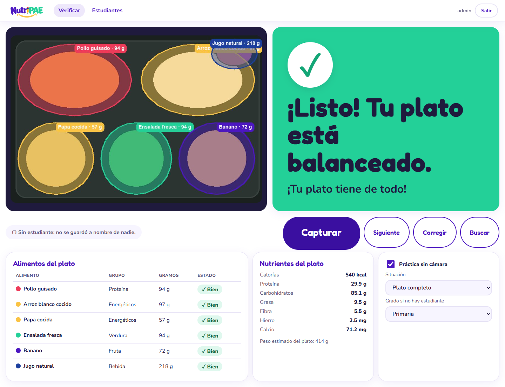
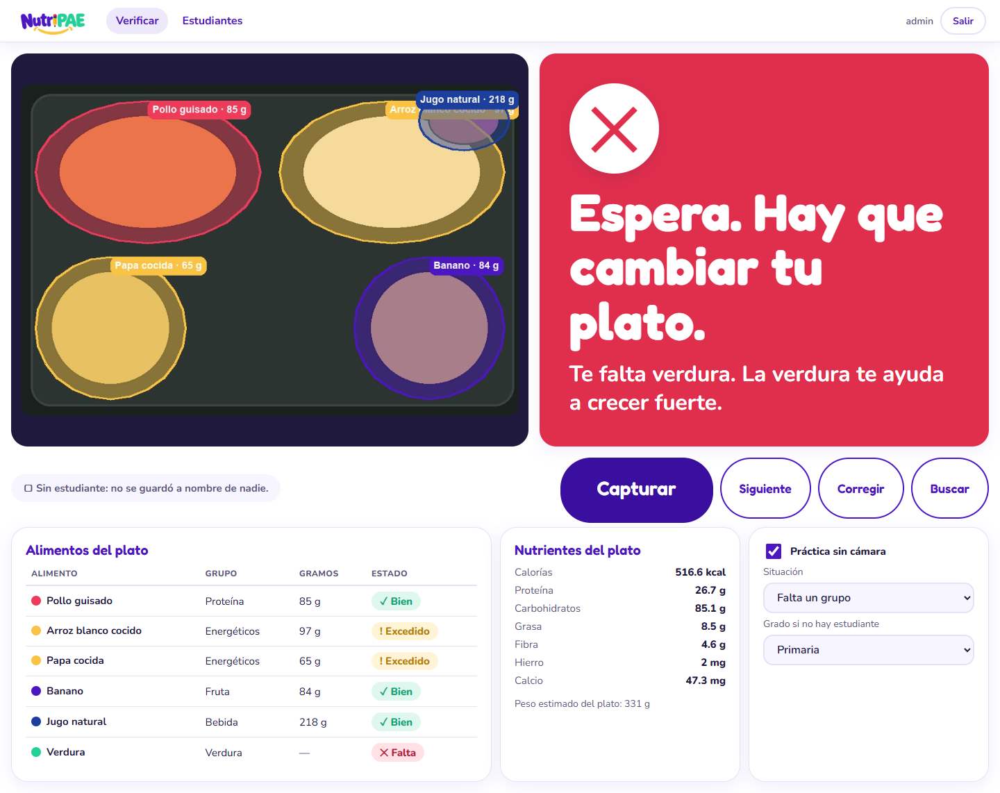
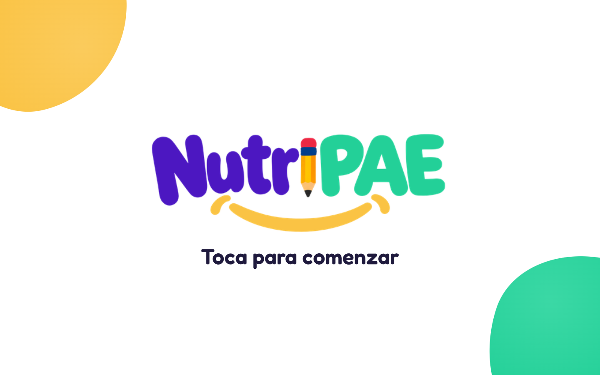
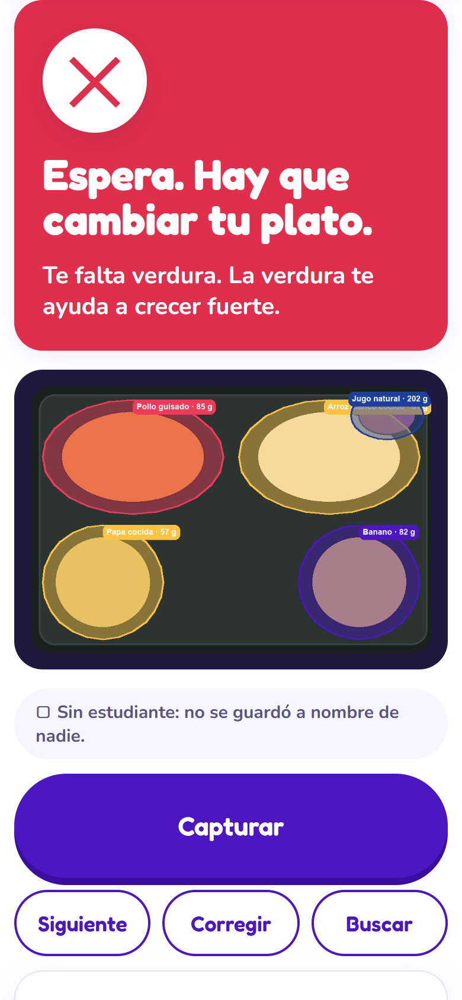
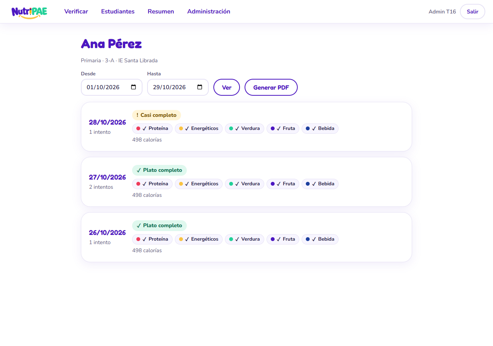
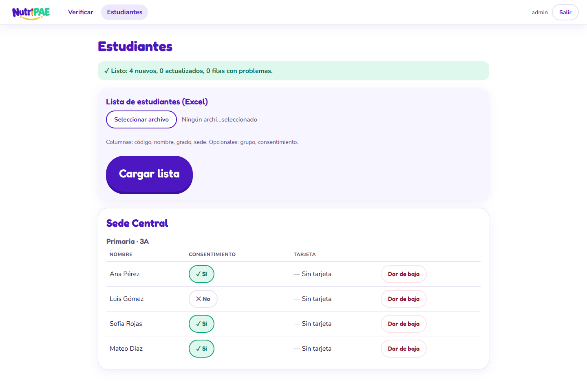

# NutriPAE — El plato balanceado, explicado al niño en el momento de servirse

NutriPAE es una app web para que cada niño del Programa de Alimentación Escolar (PAE) de Neiva aprenda, plato a
plato, qué es comer balanceado, y para que el colegio tenga el registro de qué se le sirvió a cada uno.

Todo ocurre en un solo momento: entre "me sirvieron" y "me siento a comer". El niño pone su tarjeta QR junto a la
bandeja, la cámara lee la tarjeta y el plato en una sola toma, y en menos de 10 segundos aparece el veredicto en
**dos capas** en la misma pantalla:

- **La capa del niño** (arriba, grande, legible a dos metros): semáforo con color e ícono, su nombre y una sola razón
  ("Te falta verdura. La verdura te ayuda a crecer fuerte."), y la foto del plato con cada alimento coloreado por grupo.
- **La capa de la docente** (abajo, pequeña): alimento por alimento con grupo, gramos estimados y estado, calorías y
  nutrientes, y los botones **Siguiente**, **Corregir** y **Buscar**.

Con verde el niño sigue al comedor. Con amarillo o rojo vuelve a la fila a que le completen el plato y pasa otra vez.

| Verde | Rojo | Estación fija |
|---|---|---|
|  |  |  |

| Celular de la docente | Historial del niño | Carga de estudiantes |
|---|---|---|
|  |  |  |

Ejemplos impresos: [hoja de tarjetas QR](docs/identidad/capturas/tarjetas-ejemplo.pdf) ·
[PDF del historial para la familia](docs/identidad/capturas/historial-ejemplo.pdf).

## Qué es un plato balanceado

La regla es el **método del plato** adaptado al almuerzo del PAE, no la minuta del día:

- Deben estar **proteína**, **energéticos** (cereal o tubérculo; vale uno de los dos), **verdura** y **fruta**. La
  bebida se registra pero no decide el semáforo.
- Proporciones aproximadas sobre el peso del plato sin bebida: verdura + fruta cerca de la mitad, proteína cerca de un
  cuarto, energéticos cerca de un cuarto, con tolerancia amplia.
- **Verde ✓**: están los cuatro grupos y ninguna proporción se sale mucho. **Amarillo !**: están todos pero alguna
  porción está claramente corta o muy excedida. **Rojo ✕**: falta un grupo entero o hay un alimento con mal aspecto
  (**no apto —**).
- El grado ajusta el tamaño esperado del plato y el tono del mensaje.

Los umbrales son valores iniciales propuestos por el equipo y **deben validarlos la nutricionista del proyecto**. Se
editan en *Administración → Parámetros*. Las calorías y nutrientes salen de la Tabla de Composición de Alimentos
Colombianos (ICBF).

## Ejecutar en local

Requiere Python 3.10 o superior.

```bash
python -m venv .venv
source .venv/bin/activate          # Windows: .venv\Scripts\activate
pip install torch --index-url https://download.pytorch.org/whl/cpu   # PyTorch solo-CPU, más liviano
pip install -r requirements.txt
cp .env.example .env               # Windows: copy .env.example .env
python -m nutripae.cli crear-admin admin una-clave-larga
python main.py
```

Abre `http://localhost:8000` y entra con el usuario creado. La cámara del navegador funciona en `localhost` sin
certificado; desde otro equipo de la red necesita HTTPS (ver *Despliegue*).

- **Celular de la docente**: abre `/verificar`, toca el botón de capturar con la tarjeta y el plato a la vista.
- **Estación fija** (PC con webcam cenital): abre `/verificar?estacion=1` una vez. El equipo lo recuerda: muestra la
  pantalla de inicio "Toca para comenzar", analiza solo cuando ve tarjeta y bandeja, y pasa solo a la siguiente
  bandeja. Vuelve a la pantalla de inicio tras 2 minutos sin actividad. `/verificar?estacion=0` lo desactiva.

Pruebas:

```bash
python -m pytest -q
```

La prueba que carga FastSAM de verdad se salta si `ultralytics` no está instalado.

## Modos de análisis

| Modo | Cómo se activa | Para qué |
|---|---|---|
| **IA** | `NUTRIPAE_PROVEEDOR` y su clave en el `.env`, con `NUTRIPAE_SEGMENTADOR=fastsam` (por defecto) | Uso real. FastSAM recorta los contornos del plato y la IA de visión nombra cada alimento, estima gramos y marca mal aspecto. |
| **Práctica sin cámara** | Casilla en la pantalla de verificación | Presentar o capacitar sin cámara ni internet, con un plato simulado. Esos registros quedan marcados y **nunca entran al historial** de ningún niño. |

Sin `NUTRIPAE_PROVEEDOR` el servidor no analiza fotos de la cámara y solo queda la práctica. La interfaz nunca
muestra claves, proveedores ni configuración técnica: todo se configura en el servidor.

Si la IA detecta una **persona** en la foto, la toma se descarta y se pide repetir. El análisis corre de a uno por
servidor; si dos estaciones verifican a la vez, la segunda ve "Un momento…" unos segundos.

## Roles

| Rol | Qué hace |
|---|---|
| **Niño** | Pone la tarjeta y el plato y lee el veredicto. No tiene cuenta. |
| **Docente** | Verifica platos en el celular o la estación, busca al niño sin tarjeta, corrige un alimento mal nombrado y abre el historial de un niño de su sede. |
| **Nutricionista** | Ve el historial de cualquier niño de sus sedes, genera el PDF para la familia y ve el resumen por sede y grado. |
| **Administrador** | Carga estudiantes desde Excel, imprime tarjetas QR, crea usuarios y asigna sedes, da de baja estudiantes y edita los parámetros. |

Un usuario puede tener varios roles. Cada usuario ve solo sus sedes. Los padres no entran al sistema: reciben el PDF
impreso o por WhatsApp de manos del colegio.

## Estudiantes desde Excel

*Administración → Estudiantes → Cargar Excel*. La primera fila son los encabezados:

| Columna | Obligatoria | Contenido |
|---|---|---|
| `codigo` | Sí | Código del estudiante: número de lista con grado, código interno o documento de identidad. |
| `nombre` | Sí | Nombre completo. |
| `grado` | Sí | Grado con su número (`3`, `3°`, `10`) o `transición`; el sistema lo agrupa en preescolar, primaria o secundaria. |
| `sede` | Sí | Sede educativa, con el mismo nombre que se asigna a los usuarios. |
| `grupo` | No | Curso, por ejemplo `3-A`. Si falta, todo el grado es un grupo. |
| `consentimiento` | No | `sí` o `no`. Si falta la columna, se asume **no**. |

- **El código debe ser único en todo el piloto**, no solo en la sede. Volver a cargar el archivo actualiza por código y
  no duplica.
- Un código de 6 o más dígitos se trata como **documento de identidad** y se guarda solo su huella irreversible, nunca
  en claro. Esa huella usa `NUTRIPAE_SECRET`: si se cambia la clave secreta, volver a cargar el mismo Excel crea
  estudiantes duplicados. No la cambies durante el piloto.
- El orden de lista es el orden de las filas dentro de cada grupo; la búsqueda sugiere arriba al siguiente en lista.
- El consentimiento también se marca o retira después, estudiante por estudiante.

## Tarjetas QR

*Administración → Estudiantes → Imprimir tarjetas* genera un PDF por curso, listo para imprimir y plastificar, con
nombre, grado, sede y el QR. **El QR contiene solo el código de la tarjeta**, nunca el nombre ni otros datos: una
tarjeta perdida no expone nada y el administrador puede anularla y generar otra. Un niño sin consentimiento no recibe
tarjeta. El QR se lee en el navegador; la foto solo viaja al servidor para analizar el plato.

Si el niño no tiene tarjeta, la docente toca **Buscar** y elige su nombre en la lista del grado.

## Historial y PDF para la familia

Desde la búsqueda o la lista de estudiantes se abre el historial de un niño: un día por fila con la foto anotada, los
alimentos, gramos, calorías y semáforo, los intentos del día y con qué frecuencia faltó cada grupo. Si el niño pasó
varias veces en el mismo almuerzo, cuenta la última y las anteriores quedan como intentos.

El botón **Generar PDF** genera el informe para la familia en el periodo elegido, en lenguaje sin jerga y con una o dos fotos
de ejemplo. El sistema no lo envía a nadie. Cada consulta del historial y cada PDF queda en la auditoría. La
nutricionista ve además el resumen por sede: platos verdes por día, el grupo que más falta y los alimentos no aptos.

## Administración

- **Estudiantes**: carga del Excel, consentimiento, baja, tarjetas por curso y anulación de una tarjeta.
- **Usuarios**: crear, asignar roles y sedes, desactivar.
- **Parámetros**: umbrales del plato balanceado y lista de alimentos conocidos con su grupo.

## Configuración (`.env`)

| Variable | Uso |
|---|---|
| `NUTRIPAE_SECRET` | Firma la sesión y la huella de los documentos. **Obligatoria en producción** y estable durante el piloto. |
| `OPENAI_API_KEY` / `ANTHROPIC_API_KEY` / `GEMINI_API_KEY` | Clave de la IA de visión; basta la del proveedor elegido. Para Claude o Gemini instala además `anthropic` o `google-genai`. |
| `NUTRIPAE_PROVEEDOR` | `openai`, `anthropic` o `gemini`. Sin ella no hay análisis con cámara. |
| `NUTRIPAE_MODELO` | Opcional. Por defecto `gpt-4.1-mini`, `claude-sonnet-5-5` o `gemini-2.5-flash`. |
| `NUTRIPAE_SEGMENTADOR` | `fastsam` (por defecto) o `demo`, contornos simulados sin PyTorch para pruebas. |
| `NUTRIPAE_MUESTRA_DIA` | Originales que se guardan por día y sede para entrenar el modelo propio. Por defecto 50. |
| `NUTRIPAE_DB` | Ruta de la base SQLite. Por defecto `data/nutripae.db`. |
| `NUTRIPAE_FOTOS` | Carpeta de fotos. Por defecto `data/fotos`. |
| `NUTRIPAE_HTTPS` | `1` para que la cookie de sesión solo viaje por HTTPS. El script de despliegue la activa. |

El `.env` está en `.gitignore`: nunca se sube al repositorio.

## Despliegue en AWS Lightsail (plan de 12 USD, 2 GB RAM, Ubuntu)

```bash
git clone <tu-repo> /home/ubuntu/nutripae && cd /home/ubuntu/nutripae
chmod +x deploy/setup_lightsail.sh
sudo NUTRIPAE_ADMIN=admin NUTRIPAE_ADMIN_PASS='una-clave-larga' deploy/setup_lightsail.sh tu-dominio.edu.co
nano .env                                   # OPENAI_API_KEY y NUTRIPAE_PROVEEDOR
sudo systemctl restart nutripae
sudo apt install -y certbot python3-certbot-nginx && sudo certbot --nginx -d tu-dominio.edu.co
```

El script crea **2 GB de swap** (PyTorch y FastSAM usan cerca de 1 GB al analizar), instala PyTorch solo-CPU y las
dependencias, descarga los pesos `FastSAM-s.pt`, genera `NUTRIPAE_SECRET`, activa `NUTRIPAE_HTTPS=1`, crea el servicio
`nutripae` (systemd) y el proxy Nginx, y crea el primer administrador si recibe las dos variables.

- **HTTPS es obligatorio**: sin certificado el navegador no deja usar la cámara. Abre los puertos 80 y 443 en el
  firewall de Lightsail y usa un dominio.
- El servicio corre **un solo proceso** de uvicorn (`--workers 1`): la cola de análisis vive dentro del proceso.
  Con más procesos se analizarían varias fotos a la vez y la memoria no alcanza.
- Si las esperas se vuelven habituales en el piloto, se sube al plan de 4 GB (2 vCPU) antes que complicar el software.

## Datos y privacidad

NutriPAE **sí guarda datos personales de menores**: nombre, grado, grupo, sede, la foto de su bandeja y qué se le
sirvió cada día. Por eso:

- **Consentimiento informado**: el colegio lo recoge de padres o acudientes. El sistema solo registra a un niño si el
  consentimiento está marcado. Sin consentimiento el niño recibe igual el veredicto en pantalla, pero **no se guarda
  nada a su nombre** y no se le genera tarjeta.
- **Qué se guarda por verificación**: alimentos, grupos, gramos estimados, nutrientes, semáforo, hora, sede, quién
  verificó, las correcciones de la docente y la foto anotada reducida (lado mayor **1024 px**, unos 100–150 KB).
- **Muestra para entrenamiento**: además, el original sin anotar de una muestra de **50 bandejas por día y sede**
  (configurable con `NUTRIPAE_MUESTRA_DIA`), nunca de todas. Servirá para entrenar el modelo propio de la fase 2.
- **Sin rostros**: la cámara apunta solo a la bandeja, desde arriba. Si la IA detecta una persona, la toma se
  descarta y se pide repetir.
- **Acceso**: usuario y contraseña; cada usuario ve solo sus sedes; queda registro de quién consultó un historial o
  generó un PDF.
- **Documento de identidad**: si el colegio lo usa como código, se guarda solo su huella irreversible.
- **Retención**: las fotos se conservan durante el año escolar y luego se borran; los datos tabulares se conservan
  mientras el niño esté en el programa. Al cerrar el año escolar el administrador ejecuta en el servidor:

  ```bash
  .venv/bin/python -m nutripae.cli borrar-fotos-antiguas --antes 2027-12-01
  ```

  Borra las fotos de historial y de entrenamiento tomadas antes de esa fecha, conserva los registros y muestra
  `Fotos eliminadas: N`.
- **Ubicación del servidor**: el servidor está en … *(el operador completa aquí la región de la instancia; si no
  está en Colombia, se documenta dónde está)*.
- La IA de visión es un servicio externo: la foto de la bandeja se envía para su análisis. No se envían nombres ni
  códigos.

## Ruta de la IA

- **Hoy (piloto), sin entrenar ningún modelo**: **FastSAM** (paquete `ultralytics`) recorta la bandeja en contornos
  sin saber qué son, en CPU en 1–2 s. La **IA de visión** por API nombra cada alimento, lo ubica, estima gramos con
  la bandeja como escala y marca mal aspecto. Cada contorno recibe el nombre y el grupo del alimento ubicado en esa
  zona; los contornos sin alimento se descartan.
- **Fase 2**: modelo **YOLO-seg** propio entrenado con la muestra de fotos del piloto (con autorización de las sedes y
  revisión de nutricionistas), corriendo en el PC de la estación sin internet. Las correcciones de las docentes son
  etiquetas para ese entrenamiento.

## Identidad visual

- Logotipo "NutriPAE" con lápiz y sonrisa: `nutripae/web/static/img/logo.png` en la app y
  `docs/identidad/logo-fondo-blanco.png` para impresión. Icono: el lápiz (`icono.png`, `favicon.png`).
- Paleta: morado `#4C17C1` (principal), verde `#23D098`, amarillo `#FAC344`, rojo lápiz `#EE3B5A`, azul `#1C3F9E` y
  tinta `#1F1A3D`.
- Semáforo siempre con ícono: verde ✓, amarillo !, rojo ✕, no apto —.
- Grupos sobre la foto: proteína rojo, energéticos amarillo, verdura verde, fruta morado, bebida azul, otro gris.
- Tipografía Fredoka para títulos y veredicto, Nunito para el cuerpo. Botones de kiosco de 88 px y esquinas muy
  redondeadas.

## Estructura

```
main.py                    punto de entrada: python main.py  o  uvicorn main:app
nutripae/web/              app FastAPI: rutas, plantillas, estilos, lector QR y pantalla de verificación
nutripae/balance.py        plato balanceado: grupos, proporciones y semáforo
nutripae/messages.py       frases para el niño, variadas por grupo y semáforo
nutripae/vision.py         IA de visión por API y plato simulado de la práctica
nutripae/segment.py        contornos con FastSAM (o simulados)
nutripae/fuse.py           cruce contorno ↔ alimento
nutripae/overlay.py        foto anotada por grupo de alimento
nutripae/analyze.py        análisis completo con cola de a uno
nutripae/verificaciones.py guardado con consentimiento, fotos y muestra de entrenamiento
nutripae/students.py       Excel, búsqueda, siguiente en lista, consentimiento
nutripae/cards.py          tarjetas QR en PDF
nutripae/history.py        historial por niño y resumen por sede
nutripae/reports.py        PDF para la familia
nutripae/retention.py      borrado de fotos al cerrar el año escolar
nutripae/auth.py           usuarios, contraseñas, roles y sedes
nutripae/cli.py            crear-admin, borrar-fotos-antiguas
nutripae/nutrition.py      tabla de composición ICBF
nutripae/foods.py          alimentos conocidos y su grupo
deploy/                    Lightsail: script de instalación, systemd y Nginx
docs/                      postulación, diseño, identidad visual y capturas
```

## Licencia

MIT — equipo NutriPAE, Neiva 2026.
